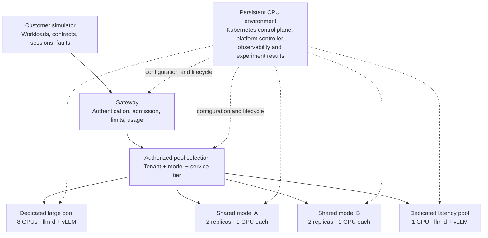

# kubernetes-llm-inference-platform

A Kubernetes-native LLM inference platform built with llm-d and vLLM, designed to support multi-tenant serverless, provisioned-throughput, and dedicated GPU serving. It explores SLO-aware routing, tenant isolation, GPU capacity planning, and cost-efficient serving through realistic customer workload simulation, performance experiments, fault injection, and end-to-end observability.

## Architecture

The platform combines independently deployable GPU serving profiles with a persistent CPU environment for control, observability, and experiment results.



## Shared contracts

The first implemented layer is an offline Python contract package. It defines customer requirements,
traffic scenarios, frozen run inputs and results, Lambda worker groups, serving profiles, operation
progress, and infrastructure inventory. It includes all five customer examples:

| Customer | Workload | Dataset basis | Serving candidate |
| --- | --- | --- | --- |
| WriterAssist | Sentence correction | JFLEG | Dedicated Qwen3-4B |
| CodeAgent | Recorded coding-call replay | Exgentic v2 / SWE-bench | Dedicated Qwen3-235B-A22B |
| TutorChat | Multi-turn tutoring | MathDial | Provisioned share of Qwen3-8B |
| DocFlow | Document-text extraction | CUAD | Best-effort Qwen3-14B |
| ResearchAgent | Prepared research QA steps | HotpotQA | Provisioned share of the same Qwen3-14B |

All traffic, SLO and hardware settings are experimental defaults. The source manifests are not
prepared datasets, and the runtime fixtures contain synthetic measurements. No cloud resources,
inference services, dataset preparation, or benchmark execution are implemented by this layer.

## Workload execution

Stream A implements public/synthetic preparation, immutable planning, AIPerf 0.13.0 execution,
request/session measurement, SLO and task-quality evaluation, cancellation and reports for all five
profiles and seven scenarios. Local runs use an OpenAI-compatible CPU stub and are explicitly
synthetic/emulated. Live benchmarking keeps strict artifact, version and readiness preflight.

Start with the [workload development guide](docs/development/workloads.md),
[management integration notes](docs/development/workload-integration.md), and
[recovery runbook](docs/runbooks/workload-recovery.md).

### Install and verify

Install [uv](https://docs.astral.sh/uv/getting-started/installation/), then run these commands from the
repository root. uv uses the Python 3.12 version selected by `.python-version`.

```bash
uv sync --locked --all-packages
uv run --locked --package platform-contracts pytest
uv run --locked --package platform-contracts ruff check .
uv run --locked --package platform-contracts ruff format --check .
bash scripts/check-generated.sh
```

The package can load and resolve the examples without network access after installation:

```bash
uv run --locked --package platform-contracts python - <<'PY'
from pathlib import Path
from platform_contracts import ServingBinding, build_run_snapshot, load_catalog

catalog = load_catalog(Path.cwd())
snapshot = build_run_snapshot(
    catalog,
    "writer-assist-baseline@1",
    (
        ServingBinding(
            customer_ref="writer-assist@1",
            serving_profile_ref="gec-baseline@1",
            worker_group_ref="latency-workers@1",
            deployment_id="gec",
        ),
    ),
)
print(snapshot.scenario.ref)
print(snapshot.scenario.measurement_duration_s)
PY
```

This constructs a draft snapshot. `validate_for_execution(snapshot)` deliberately rejects it until
dataset artifacts, provider selections, version pins, an inventory snapshot, and an admission
schedule have been supplied. That preflight checks offline completeness, not live capacity or
deployment readiness.

### Files and generation

- [Python contracts and interface notes](packages/platform-contracts/README.md)
- [Customer defaults and scenario mappings](configs/customers/README.md)
- [Dataset provenance and preparation boundaries](datasets/README.md)
- [Runtime fixtures and schema conventions](contracts/README.md)

Author configurations under `configs/` and source manifests under `datasets/manifests/`. Generate
JSON Schemas from the Python models; do not edit the exported schemas by hand:

```bash
uv run --locked --package platform-contracts python scripts/export-contracts.py
```

CI runs the same checks and rejects schema drift. The management API exports OpenAPI from its real routes and generates a TypeScript client; see the
management development guide below for regeneration and drift checks.

## Management application

Stream C adds KLIP, a graph-based local management workspace with authenticated configuration
authoring, immutable revisions, durable operations, live Lambda inventory and labelled simulation.

```bash
./dev/start
```

The startup command prompts for the `admin` password on first use, migrates PostgreSQL and seeds
examples. Open [localhost:5173](http://localhost:5173). See the
[development guide](docs/development/management.md) and
[recovery runbook](docs/runbooks/management-recovery.md) for workflows, secrets and verification.

Lambda observations are read-only. Allocation and cluster lifecycle workflows retain their simulation
adapters. Management can launch A's actual runner as a Kubernetes Job against the local stub, and can
onboard B-managed GPU capacity for strictly gated live execution. Synthetic results are not live
model performance measurements.

Management integration handoffs, Kubernetes Jobs and immutable imports are described in the
[integration guide](docs/development/management-integrations.md). Production images, C-owned charts,
the isolated kind proof and explicit release workflow are in the
[deployment guide](docs/development/management-deployment.md). Real cloud mutations and benchmark
execution remain blocked until their downstream readiness requirements are satisfied.

## Managed workload integration

Run the CPU-only A↔C proof with `KLIP_WORKLOAD_INTEGRATION=1 ./dev/test-integration`. It exercises all
seven workload scenarios through management, artifact downloads, recovery and cancellation. See the
[A/B/C integration notes](docs/development/workload-integration.md) and
[live validation runbook](docs/runbooks/live-inference-validation.md) for external capacity imports,
the first pinned direct-vLLM WriterAssist run, subsequent profiles and 20-minute campaigns.
