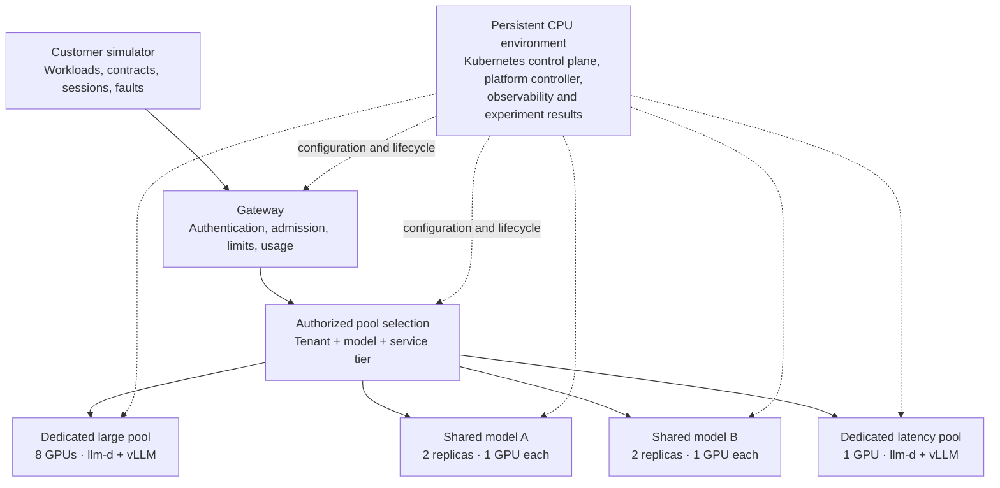

# kubernetes-llm-inference-platform

A Kubernetes-native LLM inference platform built with llm-d and vLLM, designed to support multi-tenant serverless, provisioned-throughput, and dedicated GPU serving. It explores SLO-aware routing, tenant isolation, GPU capacity planning, and cost-efficient serving through realistic customer workload simulation, performance experiments, fault injection, and end-to-end observability.

## Architecture

The platform combines independently deployable GPU serving profiles with a persistent CPU environment for control, observability, and experiment results.

