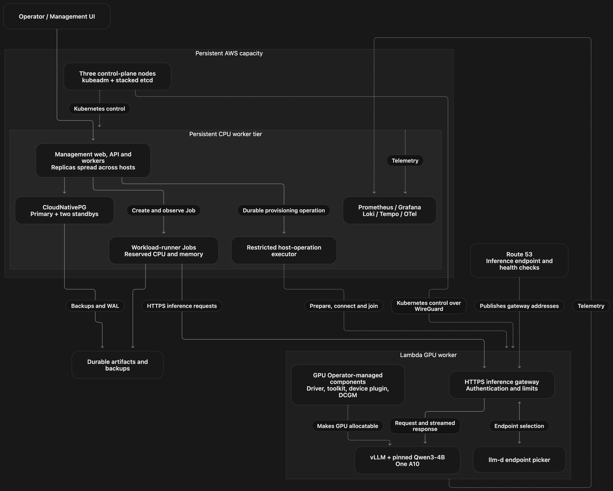
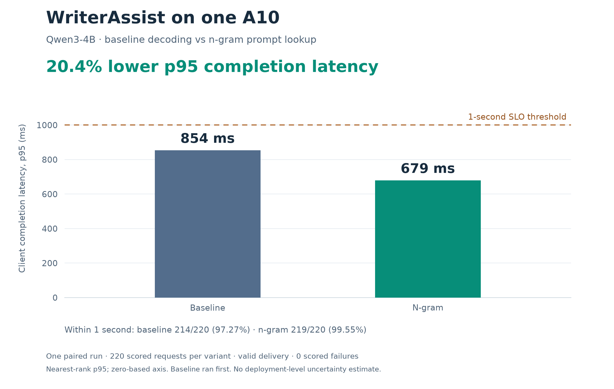

# Kubernetes LLM Inference Platform



*Architecture overview. The [validated A10 scope](#architecture-and-validated-scope)
describes the exact networking, placement and GPU-runtime configuration measured.*

**Deploy LLM serving, run reproducible workloads, and measure whether customers' latency targets are met.**

KLIP combines a self-managed Kubernetes cluster, a Python/React management application,
llm-d and vLLM serving, and an AIPerf-based workload pipeline. Infrastructure, host
preparation, deployment configuration and observability live alongside the application
in this monorepo.

**Environment status — 5 November 2026:** the AWS experiment environment has been
decommissioned. Hosted management and Grafana endpoints are offline. The measured
results, plots and local workflows remain available here. See the
[decommission record and rebuild prerequisites](docs/runbooks/full-project-decommission.md).

[Measured results](#headline-experiment) · [Architecture](#architecture-and-validated-scope) ·
[Repository map](#repository-map) · [Run locally](#run-locally) · [Documentation](docs/README.md)

## What this project does

- **Builds the platform:** Terraform provisions AWS resources; Ansible prepares hosts,
  WireGuard connectivity and kubeadm. Three control-plane nodes use stacked etcd;
  persistent CPU workers host management and telemetry.
- **Manages durable operations:** an authenticated UI, FastAPI, PostgreSQL and background
  workers manage versioned configurations, capacity observations, runs and artifacts.
  Restricted host operations and provider adapters have separate credentials and ownership.
- **Serves models:** Helm releases configure GPU runtime components, model deployments,
  authenticated routing and llm-d endpoint selection. Externally retained capacity has
  explicit safeguards against automatic resize, expiry or deletion.
- **Exercises customer workloads:** seeded schedules, public-data preparation, ordered
  sessions and immutable snapshots feed AIPerf. Execution, measurement validity, SLOs
  and task quality are reported separately.
- **Makes behavior observable:** Prometheus/Thanos, Grafana, Loki, Tempo, OpenTelemetry,
  Hubble and DCGM expose infrastructure, application, request-path and GPU diagnostics.

## Headline experiment

**N-gram prompt lookup reduced WriterAssist client p95 completion latency by 20.4%
in one paired A10 experiment: 854 ms → 679 ms.**



This was real inference through the private llm-d gateway, using **Qwen3-4B on one
NVIDIA A10**. One dashboard action activated the two pinned serving configurations,
ran separate immutable child Jobs, evaluated the results and registered downloadable
reports. The complete pair took **17 minutes 49 seconds**.

| Measured outcome | Baseline | N-gram |
| --- | ---: | ---: |
| Client completion p50 | 527.18 ms | 377.45 ms |
| Client completion p95 | 853.79 ms | 679.30 ms |
| Client completion p99 | 1,083.17 ms | 961.24 ms |
| Within one second | 214/220 · 97.27% | 219/220 · 99.55% |
| SLO verdict | Passing | Passing |
| Scored requests / successful outputs | 220 / 220 | 220 / 220 |
| Common-cohort GLEU | 0.426734 | 0.425763 |
| Speculative token acceptance estimate | N/A | 11.38% |

Both variants had valid delivery, no scored failures and no missed admissions.
The fixed target was at least 95% completion within one second, over a 300-second
window with at least 100 eligible requests. Non-streaming requests provide client
completion latency; client TTFT is unavailable.

**Why n-gram?** WriterAssist uses JFLEG grammatical-error correction and fluency
editing. Corrections often preserve contiguous input spans that prompt lookup can
propose for target-model verification, without loading a separate draft model.
Fluency rewrites and lookup overhead can reduce the benefit. Prefix caching was
disabled in both variants.

The same selected JFLEG inputs and seeded arrivals were reused across variants,
with development data for warmup and test data for scoring. All four references
were retained outside inference payloads. Each variant had 60 seconds warmup and
300 scored seconds. N-gram used five speculative tokens and lookup bounds 2–5.

This is **one baseline-first comparison**, with short inputs and possible order/warm-state
effects. The slightly lower GLEU does not establish quality equivalence. Acceptance is
a scrape-based diagnostic, not a baseline percentage or a speedup measure. Public
JFLEG data is a task proxy, not private customer traffic.

- [Detailed measured results and stage timings](docs/experiments/writer-assist-a10-dashboard-2026-11-04.md)
- [Experiment specification and methodology](experiments/writer-assist-a10/ngram-comparison.md)
- [Public aggregate data](experiments/writer-assist-a10/results/2026-11-04-summary.json)
- [Reproduce the custom Matplotlib figures](experiments/writer-assist-a10/README.md)
- [Run the paired experiment from management](docs/runbooks/dashboard-a10-comparison.md)

## Architecture and validated scope

The lead image shows the broader platform architecture. The measured A10 request path was:

```text
Management → CPU workload-runner Job → private authenticated llm-d gateway
           → endpoint picker → vLLM / Qwen3-4B on the A10
```

Management, PostgreSQL and Kubernetes control-plane services stay outside the
per-token inference path. For this experiment, the gateway and endpoint picker ran
on CPU workers. The inference Service used private HTTP inside the WireGuard-connected
cluster; the public HTTPS/Route 53 inference path in the diagram was not benchmarked.
Management itself used authenticated HTTPS.

| Layer | Implementation |
| --- | --- |
| AWS foundation | Terraform; private Kubernetes API endpoint; persistent CPU capacity; storage, identity, DNS and monitoring roots |
| Cluster and host networking | kubeadm with three stacked-etcd control planes; Ansible; host WireGuard; Cilium Pod networking and Hubble |
| Management | React/TypeScript, FastAPI, durable Python workers, CloudNativePG PostgreSQL and shared artifact storage |
| GPU and serving | NVIDIA GPU Operator components, device plugin and DCGM; Helm; llm-d gateway/endpoint picker; vLLM |
| Workload and evaluation | AIPerf 0.13.0; preparation adapters; frozen schedules/snapshots; pure SLO evaluator; task-quality reports |
| Observability | Prometheus, Thanos, Grafana, Loki, Tempo, OpenTelemetry, DCGM and host/network telemetry |

The retained A10 used its **preinstalled driver and toolkit**. GPU Operator supplied
validation/discovery, device exposure and telemetry; driver/toolkit installers were
disabled for that host. The diagram's fully operator-managed driver/toolkit path is
a broader deployment option, not the tested host configuration.

HA management and PostgreSQL, backup/restore procedures, and API/worker replacement
were exercised. The paired-run recovery check preserved the same runner Job,
snapshot and clock across management Pod replacements; cancellation retained a
partial result and prevented the next variant from starting.

The single A10 is **not redundant model-serving capacity**. The five customer paths
have local preparation/execution coverage, but this headline result validates only
WriterAssist on the stated deployment. Full mixed-GPU performance, sustained failure
campaigns and a complete destructive destroy/rebuild acceptance remain separate work.
Time-limited model/EPP vulnerability reviews apply to the private experiment;
this repository does not claim production certification. See the
[acceptance ledger](docs/development/end-to-end-platform.md) and
[security guidance](SECURITY.md).

## Repository map

This is one repository containing the application, shared packages and platform code.

| Location | What it owns |
| --- | --- |
| [apps/management/](apps/management/README.md) | Web UI, FastAPI, PostgreSQL persistence, durable jobs, provider integration and restricted host executor |
| [workload-runner/](workload-runner/README.md) | Data preparation, scenario compilation, AIPerf integration, execution control, quality and reports |
| [packages/platform-contracts/](packages/platform-contracts/README.md) | Pydantic contracts, loading, immutable snapshots and cross-resource validation |
| [packages/slo-evaluator/](packages/slo-evaluator/README.md) | Request/session classification, fixed-window SLOs and latency summaries |
| [configs/](configs/README.md) | Versioned customers, scenarios, worker groups and serving examples |
| [datasets/](datasets/README.md) | Source manifests, provenance and preparation boundaries |
| [contracts/](contracts/README.md) | Generated JSON Schemas, management OpenAPI and synthetic runtime fixtures |
| [infra/](infra/README.md) | Terraform roots/modules, Ansible roles/playbooks and inventory interfaces |
| [charts/](charts/README.md) | Helm packaging for application, database, model, storage, identity and telemetry boundaries |
| [deploy/](deploy/README.md) | Dependency/image locks, environment overlays, reviews and release configuration |
| [observability/](observability/README.md) | Grafana dashboards, dashboard builders and host metric exporters |
| [dev/](dev/README.md) | Local Compose stack, inference stub, integration environment and container definitions |
| [experiments/](experiments/README.md) | Experiment methodology, public aggregate observations and preparation evidence |
| [scripts/](scripts/README.md) | Schema generators, custom plotting, smoke checks and guarded operator commands |
| [docs/](docs/README.md) | Architecture, development guides, operator runbooks and measured acceptance records |
| [tests/infrastructure/](tests/infrastructure/) | Offline checks for infrastructure, security boundaries and operator behavior |

### Workload profiles

| Profile | Task proxy | Serving candidate | Evidence scope |
| --- | --- | --- | --- |
| WriterAssist | JFLEG grammar correction | Dedicated Qwen3-4B | Local pipeline and real A10 comparison above |
| CodeAgent | Exgentic v2 / SWE-bench-filtered inference replay | Dedicated Qwen3-235B-A22B | Local pipeline; no tool execution or functional-agent score |
| TutorChat | MathDial tutoring dialogues | Shared Qwen3-8B | Local pipeline; pedagogical quality remains unevaluated |
| DocFlow | CUAD document-text extraction | Shared Qwen3-14B | Local pipeline; adapted extraction, not OCR or official CUAD scoring |
| ResearchAgent | HotpotQA evidence/answer steps | Same shared Qwen3-14B deployment | Local pipeline; not a complete web agent |

Rates, hardware choices and customer targets are experimental defaults. See
[customer configuration notes](configs/customers/README.md) for the full mapping.

## Run locally

### Management UI

Requires Docker Engine/Desktop with Compose v2:

```bash
./dev/start
```

Choose an admin password on first start, then open <http://localhost:5173>.
The default local lifecycle is simulated; examples and stub results are labelled.
No cloud credentials or GPU are required. See the
[management development guide](docs/development/management.md).

### CPU-only workload pipeline

Requires Python 3.12 and [uv](https://docs.astral.sh/uv/). From the repository root:

```bash
uv sync --locked --all-packages --all-extras
uv run --locked --all-packages --all-extras python scripts/smoke-workloads.py \
  --prepare --output artifacts/workloads/local-smoke
```

The driver starts a temporary local stub and runs the five standalone and two mixed
scenarios. Use a fresh output directory for each attempt. Generated text, token usage
and measurements in this mode are synthetic/emulated. It downloads no benchmark
corpora and provisions no resources. See the [workload guide](docs/development/workloads.md)
for individual CLI commands, public preparation and live preflight.

### Reproduce the figures

```bash
uv run --locked --group plots python scripts/plot_a10_results.py
```

The Matplotlib script reads the checked-in aggregate results and writes PNG/SVG
figures under `docs/assets/experiments/`. It needs no cluster, raw dataset or credentials.

## Development checks

```bash
uv sync --locked --all-packages
uv run --locked --all-packages pytest
uv run --locked --all-packages ruff check .
uv run --locked --all-packages ruff format --check .
bash scripts/check-generated.sh
uv run --locked --all-packages python scripts/export-management.py --check
```

Frontend checks, PostgreSQL-backed tests, generated clients and opt-in CPU/Kubernetes
integration commands are documented in [CONTRIBUTING.md](CONTRIBUTING.md). Public-data
preparation and live GPU tests are separate from offline CI.

## Deploy and operate

Start with the [documentation index](docs/README.md),
[infrastructure overview](infra/README.md) and [deployment guide](docs/development/management-deployment.md).
Terraform and operator inputs contain project-specific account, region, domain and
capacity settings; review them before deploying your own environment. Image locks,
Secret references, artifact storage, readiness and security reviews must be configured
before a live run. Infrastructure commands may create billable resources.

The [teardown/recovery runbooks](docs/runbooks/foundation-teardown.md) distinguish
replaceable compute from retained data, keys and state. The manually retained A10 is
protected from automated expiry and deletion. Source code and runbooks are not proof
that a complete destructive rebuild has been exercised.

## License

Repository source code is licensed under [Apache-2.0](LICENSE). Datasets, model weights,
container images and upstream dependencies retain their own licenses; source manifests
record the dataset evidence. Raw corpora, captured responses, credentials and private
execution bundles are excluded from Git.
