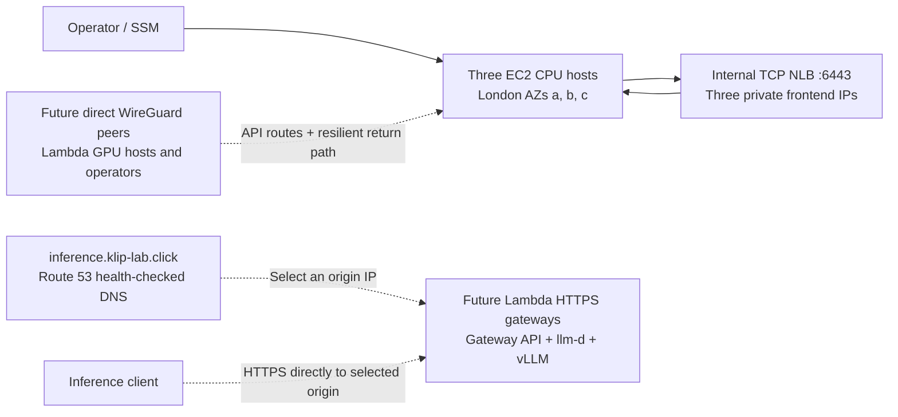

# AWS foundation

Terraform provides the AWS resources used by the Ansible-managed Kubernetes cluster.
Its allocations, observed host access and cluster readiness remain separate facts.
See the [host and Kubernetes architecture](kubernetes-bootstrap.md) for WireGuard,
kubeadm, Cilium, Hubble and metrics-server. AWS status checks and SSM complement
those components. Prometheus, Grafana, Loki, Tempo, OpenTelemetry and GPU/DCGM
telemetry remain deferred to later platform stages.

The cluster uses kubeadm/containerd with three stacked etcd members. The
management backend allocates Lambda VMs; Terraform owns only the AWS foundation.
The backend and CPU environment stay outside the per-token serving path. No EKS,
custom Lambda operator, provisioning CRD or Go controller is introduced.

## Addressing and immutable defaults

The canonical deployment configuration is `infra/terraform/project.json`. The account
is `127811062476`, region `eu-west-2`, cluster `klip`. Three on-demand `m7i.large`
hosts use Canonical Ubuntu 24.04 image `ami-057b46c043e81dcf4`. AMI and provider
upgrades require reviewed configuration changes; plans never select a newer image.

| Slot | AZ | Native private IP | WireGuard assignment | Private NLB frontend |
| --- | --- | --- | --- | --- |
| cp-01 | eu-west-2a | 10.40.0.10 | 10.200.0.11 | 10.40.16.10 |
| cp-02 | eu-west-2b | 10.40.1.10 | 10.200.0.12 | 10.40.17.10 |
| cp-03 | eu-west-2c | 10.40.2.10 | 10.200.0.13 | 10.40.18.10 |

The VPC is `10.40.0.0/16`. Public CPU subnets are `10.40.{0,1,2}.0/24`;
private API subnets are `10.40.{16,17,18}.0/24`. WireGuard uses `10.200.0.0/24`,
with `.64`–`.254` reserved for future GPU workers. Pods use `10.244.0.0/16` and
Services `10.96.0.0/12`. These ranges were checked against the existing default
VPC `172.31.0.0/16` and the operator's current LAN. Validate again against each
future Lambda host's actual routes; the allocation is not proof of reachability.

## Host and network boundaries

Each host has a tagged primary ENI and one stable Elastic IP. CPU subnets use an
internet gateway for package and SSM egress; private API subnets have local VPC
routing only. There are no NAT gateways or public API load-balancer addresses.

Public UDP 51820 is intentionally permitted for future ephemeral WireGuard peers.
WireGuard authenticates peer keys at the host; opening its transport does not grant
cluster membership. Ansible manages the WireGuard service and host-generated keys;
Terraform never receives their private material.
Public SSH and native API ingress are closed. The NLB accepts API traffic from CPU
peers, and backends accept native TCP 6443 only from the NLB security group.
Package HTTP/HTTPS, VPC DNS, WireGuard transport, private API traffic and IPv4
fragmentation-needed messages are explicitly allowed. Unused AWS default security
groups are not attached to project ENIs or the NLB.

The generated NLB hostname is the kubeadm `controlPlaneEndpoint` and a
certificate SAN. TCP passes through to API servers. Private IP targets have client
IP preservation disabled so hosts can safely call their own load-balanced endpoint.
The NLB balances across AZs and checks TCP 6443 every ten seconds, using thresholds
of two. It is protected from deletion. Healthy Kubernetes API checks remain an
Ansible acceptance criterion; temporary HTTP listeners prove only TCP transport.

Each host has a 40 GiB encrypted gp3 root disk and a separately managed 20 GiB
encrypted gp3 etcd disk. The latter persists across individual instance replacement,
but is deleted during approved full foundation teardown. Ansible must identify the
data volume by EBS volume identity on Nitro/NVMe, not assume Linux `/dev/sdf` is its
actual device name. Terraform never formats or mounts it.

The explicit ENI owns source/destination checking and disables it for later mesh
forwarding. The instance resource ignores only that same field: the pinned provider
otherwise proposes its default `true`, while forbidding explicit configuration of
the field together with a primary ENI. Other instance settings remain managed.

## Ansible networking layer

Ansible establishes direct host peers before kubeadm init/join. Kubernetes node and
advertised addresses use WireGuard, with Cilium VXLAN over that reachable host
network. Future GPU-to-GPU traffic will use direct peers.
This is one cluster, not ClusterMesh; host WireGuard is distinct from optional
Cilium encryption, which is not added by this foundation.

Remote clients need routes to all three API subnet prefixes through AWS WireGuard
peers. Host automation supplies scoped SNAT/return routing and local gateway
failover. Source/destination
checks are disabled on the ENIs for this purpose. Test remote API access through
an AWS peer outage, as well as MTU, forwarding, return paths and cross-node Pod and
Service communication. The foundation's AWS-native smoke tests alone do not prove
these properties; the cluster acceptance workflow performs the stronger checks.

Inference DNS points directly to Lambda HTTPS gateway IPs. Gateway routing may
select a vLLM Pod on another worker without traversing a second gateway. Pin a
compatible Gateway API/llm-d integration in the serving stage; this slice assumes
no particular gateway implementation or NVIDIA operator.
