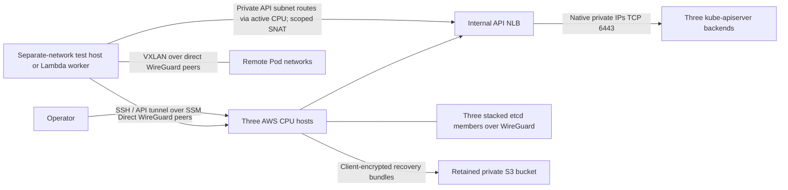

# Kubernetes host and network architecture

Terraform owns AWS resources. Ansible owns OS/runtime configuration, WireGuard and
host services. kubeadm owns control-plane static Pods and its CoreDNS/kube-proxy
add-ons, with explicit bootstrap configuration overrides. Helmfile owns the static
Cilium/Hubble, metrics-server and metadata-deny releases. C's model releases remain independent.

CPU peers use native AWS private endpoints; external peers use the CPU EIPs. Each
WireGuard peer receives its own /32 AllowedIPs. Remote API subnet prefixes belong
to exactly one CPU peer at a time. Forwarding is restricted to those prefixes on
TCP6443 and source-NATed to that CPU's native address. Other VPC destinations are
not forwarded. No VPC peering, Transit Gateway or CPU hub for GPU-to-GPU traffic is
introduced. Gateway selection is local host automation, not a Kubernetes controller.

The route helper probes known CPU API servers with the real cluster CA every five
seconds. Three failures trigger selection of a healthy alternative, with a 30-second
cooldown and no automatic failback while the current gateway works. Conntrack does
not migrate: old TCP sessions can reset. The live acceptance objective is recovery
of new authenticated API writes within 90 seconds, including NLB convergence.

Kubelet InternalIP, API advertisement and etcd peer addresses use WireGuard. The API
also listens on native interfaces for the existing NLB targets. Certificate SANs
cover the NLB hostname and declared native/WireGuard addresses. No public API or
AWS SSH ingress is added. Operator API access uses an SSM tunnel with the original
hostname for certificate verification. Inventories retain the real NLB endpoint.

WireGuard MTU is 1420; Cilium's underlying MTU override is 1420. The Pod interface
stays at 1420 while its default-route MTU is 1370, accounting for IPv4 VXLAN's
50-byte overhead. Live checks inspect both values in the actual Pod namespace and
capture VXLAN on wg0. See the [pinned Cilium MTU implementation](https://github.com/cilium/cilium/blob/v1.20.4/pkg/mtu/mtu.go).
kube-proxy stays enabled. Cilium L7 proxy/Envoy and built-in encryption
are disabled for this CPU milestone. Hubble records L3/L4 flows; its relay is private.

The cluster-wide metadata guard explicitly denies `169.254.169.254/32` and sets
`enableDefaultDeny` false for both directions. This prevents that guard from
isolating unrelated DNS/API traffic while preserving its explicit deny. Subsequent
tenant policies can establish their own default-deny rules. See [Cilium policy modes](https://docs.cilium.io/en/stable/security/policy/intro/).

The etcd EBS filesystem mounts at `/var/lib/etcd`; the database uses its `data/`
subdirectory so ext4's lost+found is not treated as cluster data. Kubelet requires
the mount and checks it before starting. Volume identity and ownership markers
prevent root fallback or accidental adoption of unrelated data. Retained data with
missing Kubernetes configuration requires recovery, never automatic init/reset.

Control-plane NoSchedule taints remain. Static control-plane resource requests,
host/runtime reservations, scoped add-on tolerations and bounded logs protect the
small CPU nodes. CoreDNS, Hubble relay and metrics-server have two replicas. Full
Prometheus/Grafana/logging/tracing, storage classes, ingress and GPU telemetry are
deferred. This milestone has host journals, metrics-server, Hubble and private
acceptance/backup freshness reports; it does not provide an external alert service.

Shared contracts are unchanged. The temporary AWS worker is an acceptance resource,
not a fabricated Lambda GPU observation. C later supplies real GPU/hardware and
serving observations; generic Kubernetes join never implies GPU or model readiness.
