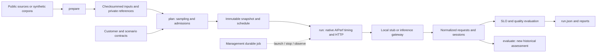

# Stream A: workloads and evaluation

Stream A prepares data, freezes scenario inputs, runs AIPerf 0.13.0, and evaluates client observations.
The same execution path serves the CPU-only local stub and live inference endpoints.
The runner doesn't provision infrastructure or implement the management API.



## Install and run without GPUs

From the repository root:

```bash
uv sync --locked --all-packages --all-extras
uv run --locked --all-packages --all-extras inference-stub --port 8001
```

In another terminal:

```bash
uv run --locked --all-packages --all-extras workload-runner prepare --customer all --limit 100
uv run --locked --all-packages --all-extras workload-runner plan \
  --scenario writer-assist-baseline --smoke --output artifacts/workloads/writer-plan
uv run --locked --all-packages --all-extras workload-runner run \
  --snapshot artifacts/workloads/writer-plan/snapshot.json \
  --output artifacts/workloads/writer-attempt
uv run --locked --all-packages --all-extras workload-runner status artifacts/workloads/writer-attempt
```

The report is `artifacts/workloads/writer-attempt/report.md`. A completed execution can have a
violating or insufficient-data performance verdict. Inspect validity and verdict separately.
Local runs are always fixtures, including runs using public inputs. Stub responses and usage are
emulated and provide no evidence of live model performance or quality.

To start a temporary stub and execute all seven synthetic smoke scenarios in one procedure:

```bash
uv run --locked --all-packages --all-extras python scripts/smoke-workloads.py \
  --prepare --output artifacts/workloads/synthetic-acceptance
```

Use a fresh output directory for a new attempt. Supported scenarios are the five
`<customer-id>-baseline` scenarios, `shared-contention`, and `platform-mixed`.

## Public preparation

Preparation is explicitly network dependent. Ordinary tests never download datasets or models.

```bash
TOKENIZERS_PARALLELISM=false uv run --locked --all-packages --all-extras workload-runner prepare \
  --source public --customer all --limit 100
uv run --locked --all-packages --all-extras python scripts/smoke-workloads.py \
  --source public --standalone --output artifacts/workloads/public-acceptance
```

Omit `--standalone` to include both mixed public-input scenarios. To run one profile manually, pass
`--source public` to `plan`; `run` consumes the resulting snapshot without configuration changes.

Default preparation bounds are 1,000 independent examples or 200 sessions, with a 1 GiB download
budget per source. `--limit` and `--byte-limit` explicitly change these bounds. Cached HTTP ranges
avoid repeatedly downloading large Parquet shards. Checksums cover actual prepared bytes.
Source exhaustion and every exclusion are reported; compilation fails before execution if the
materialized schedule needs more distinct warmup or scored records than preparation supplied.

Prepared JSONL, immutable manifests, and `latest.json` convenience pointers live under
`datasets/prepared/{synthetic,public}/<customer-id>/`. Raw downloads and range caches remain under
the ignored preparation directory. Hugging Face stores tokenizers in its normal external cache.
Keep these artifacts when retaining executions: reassessment verifies their checksums again.

| Customer | Preparation and evaluation limits |
| --- | --- |
| WriterAssist | JFLEG dev warmup and test evaluation; all four corrections retained outside payloads. Corpus GLEU+ uses 500 iterations and the upstream `iteration * 101` reference-sampling seed schedule, without sentence smoothing. Golden cases identify the pinned reference scorer. |
| CodeAgent | Exgentic SWE-bench-filtered recorded inference contexts and tool schemas. Default contiguous prefixes contain at most eight calls; `--max-turns` changes that explicit bound. Output caps, original controls, excluded calls and source call IDs are recorded. No tools run, no generated response changes a later recorded context, and no functional agent score is claimed. |
| TutorChat | MathDial student turns with live response-dependent continuation. Recorded dialogue is retained for review. A 100 ms continuation delay is an experimental assumption; pedagogical quality is not evaluated automatically. |
| DocFlow | CUAD document-text chunks retain available evidence, chunk coordinates and answer coverage. JSON clause extraction F1 is adapted evaluation, not an official CUAD score or OCR benchmark. |
| ResearchAgent | HotpotQA evidence and answer substeps with answer EM/F1 and supporting-fact scores for scorable JSON. This is not a full web-agent environment. |

Inputs exceeding the configured token limit are excluded as whole contexts. Preparation also has a
recorded character resource bound of 16 times the input-token limit before expensive tokenization;
this is an exclusion policy, not an inferred token count. For live-context sessions, prepared token
counts describe rendered inputs; capacity bounds additionally reserve prior capped responses and
16 formatting tokens per prior turn. Actual generated-context lengths remain a runtime concern.

Recorded OpenTelemetry function definitions are placed in OpenAI function envelopes for the
endpoint. Original tool schemas remain in `source_tools`, and each envelope adaptation is recorded;
tool names, descriptions and parameter schemas are preserved.

Source commits, source URLs, upstream license evidence, tokenizer commits, template digests and
preparation version appear in each manifest. Unknown licensing stays null and blocks benchmark
preflight. Dataset licenses are metadata, not a claim of authorization for every future use.
For pinned Exgentic v2, preparation uses the project-confirmed CDLA-Permissive-2.0 declaration
in its source manifest when upstream metadata is unset. Evidence records that distinction and
the exact source revision; a revision mismatch or conflicting upstream license fails preparation.
License metadata and evidence participate in preparation identity, preserving earlier manifests
and snapshots when a declaration is added or changed.
Synthetic entries have separate identities and never impersonate public corpus content.

## Scheduling and engine integration

Canonical scenarios keep their authored 60-second warmup, 180/60/360-second measurement phases,
120-second drain and customer targets. `--smoke` creates distinct derived customer/scenario IDs:
one-second warmup and one-second phases, 4/12/4 constant admissions per second, one-second drain,
500 ms request timeout, 100 ms targets, one-second windows and minimum one eligible sample.
The original versioned examples remain unchanged; lineage records the source references.

The seed determines admission and sampling streams. First turns use native AIPerf absolute
timestamps; continuations use native response-dependent relative delays. Live-context profiles
retain prior generated messages. CodeAgent preserves recorded contexts and residual delays.
HTTP concurrency is enforced per customer; native session slots also include sessions thinking
between calls and therefore have a separate bound covering the materialized schedule.

The bounded adapter uses AIPerf's plugin loader, fixed-schedule strategy and aiohttp/SSE transport.
It preserves mixed streaming behavior, model aliases, headers, credential references and timeouts.
Large raw-payload replay needs headers applied at the transport boundary in 0.13.0.
On early session abort/cutoff, remaining native credits are retired without HTTP calls so AIPerf
releases its session slot. Raw exports include these diagnostic `PlatformSuppressed` records;
they are excluded from canonical offered requests. Native aggregates are diagnostic only.

Actual send time selects request windows; later completion stays in that send window. Warmup
cohorts remain unscored across boundaries. New admissions stop at measurement end; continuation
calls sent during drain are tagged and unscored. Session aborts and cutoffs remain distinct from
missed first-turn admissions. Durations use a shared monotonic origin with UTC correlation.

Any missed due admission invalidates delivery. Lag exceeding 100 ms for more than 1% of due
first-turn admissions also invalidates delivery. These defaults are frozen in the snapshot.
There are no hidden HTTP retries. Empty/control SSE chunks aren't first output, incomplete output
is retained, and unavailable token counts stay null. Stub token counts are explicitly emulated.

## Evaluation and artifacts

`packages/slo-evaluator` is pure Python over shared contracts. It has no service, cloud, database,
Kubernetes or AIPerf dependency. Eligible in-contract errors, rejections, timeouts and cancellation
count against attainment. Windows use frozen targets and minimum sample counts. Insufficient data
cannot pass; invalid measurements have no SLO assessments. Percentiles use nearest rank.
Session-latency targets use session denominators independently from request denominators.

Every execution retains:

```text
snapshot.json                 # frozen supplied inputs, never rewritten by execution
preparation.json              # frozen provenance metadata
admission-schedule.jsonl       # copied schedule, same checksum as planning
engine-inputs.jsonl            # selected inference payloads; no gold references
engine-context.json           # adapter limits, planned sessions and header references
engine-clock.json             # common monotonic / UTC correlation
requests.jsonl                # normalized request observations, outcomes and usage provenance
sessions.jsonl                # session accounting and termination reasons
responses.jsonl               # captured output, tools and finish reasons
aiperf/                       # native raw exports, metrics, logs and transport events
run.json                      # validated execution state and canonical result
quality.json                  # scores, coverage, limitations and review bundles
report.md                     # readable execution / validity / performance / quality report
heartbeat.json                # process ownership and liveness
assessments/<timestamp>/      # later assessments and lineage; original result unchanged
```

```bash
uv run --locked --all-packages --all-extras workload-runner stop artifacts/workloads/writer-attempt
uv run --locked --all-packages --all-extras workload-runner evaluate artifacts/workloads/writer-attempt
```

Reassessment verifies retained record and preparation checksums. It never edits `run.json` or the
original quality report. CLI exit code 0 means execution completed, not that an SLO passed.
Exit code 2 represents invalid input or failed/cancelled execution.

## Tests and containers

```bash
uv run --locked --all-packages --all-extras pytest
RUN_AIPERF_INTEGRATION=1 uv run --locked --all-packages --all-extras \
  pytest workload-runner/tests/test_aiperf_integration.py
uv run --locked --all-packages --all-extras ruff check .
uv run --locked --all-packages --all-extras ruff format --check .
bash scripts/check-generated.sh
```

The integration suite uses only local HTTP and IPC; restricted environments must allow local
sockets. Public preparation remains outside offline CI. The workload workflow also builds images.

```bash
docker build -f workload-runner/Dockerfile -t klip-workload-runner .
docker build -f dev/inference-stub/Dockerfile -t klip-inference-stub .
docker run --rm klip-workload-runner --help
docker run --rm -p 8001:8001 klip-inference-stub
```

The runner image includes AIPerf/data extras and runs as UID 10001; the runtime has no compiler.
Mount a writable work directory and retain stable absolute artifact paths across preparation,
planning and execution. Management-owned Kubernetes Jobs use the execution-only entrypoint
`execute --manifest /path/to/manifest.json`; management owns attempt identity and lifecycle.
Use `run --snapshot /workspace/plan/snapshot.json --output /workspace/attempt` for local execution.
Stage artifacts and settle paths before freezing the snapshot. Execution never relocates or
rewrites supplied snapshot references. Credentials arrive through environment secret references.

Live benchmarking additionally requires verified serving/model/image pins, tokenizer-compatible
public preparations, reviewed source metadata, non-fixture inventory, recorded platform versions,
strict `validate_for_execution` and model-alias readiness. Draft examples intentionally fail this
preflight. The [recorded A10 comparison](../experiments/writer-assist-a10-dashboard-2026-11-04.md)
supplies measured WriterAssist evidence; broader hardware calibration and profile expansion
remain separate validation work.
