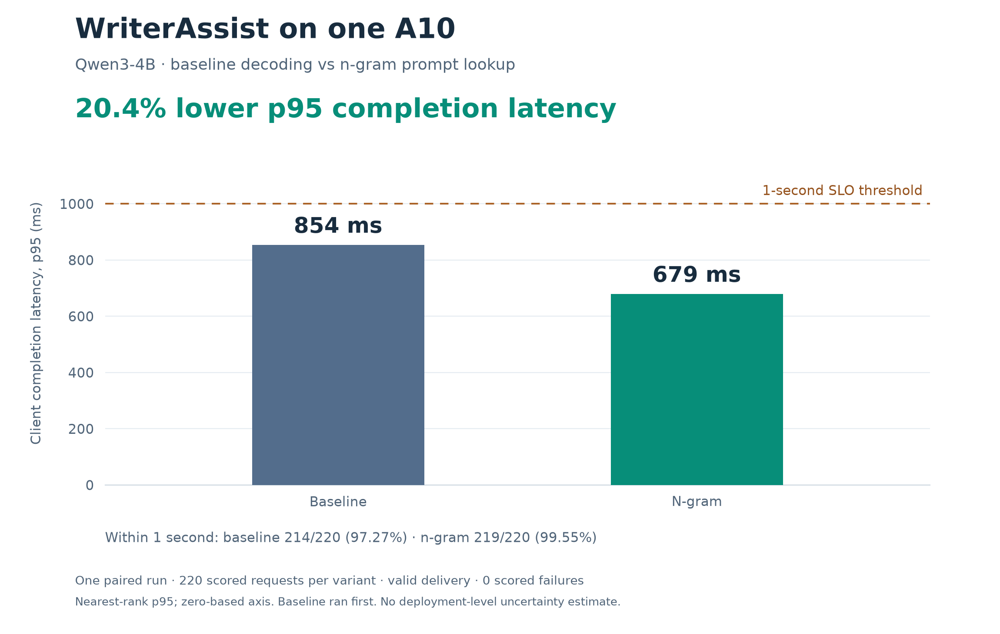
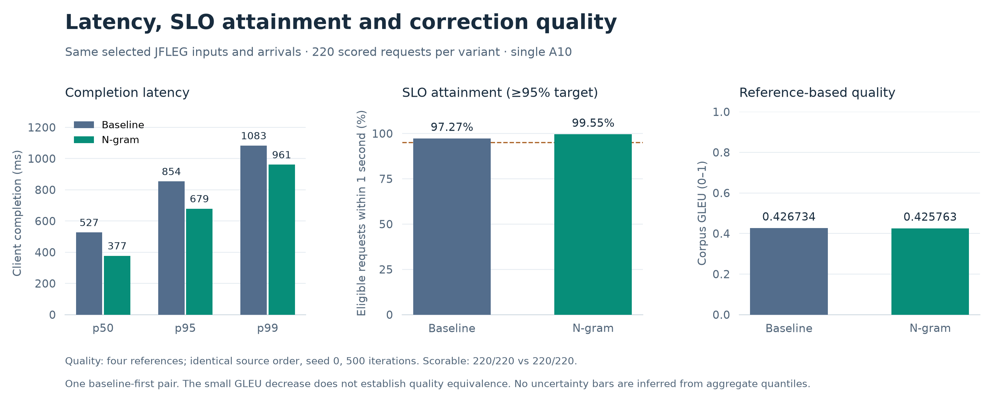

# WriterAssist: baseline vs n-gram on one A10

**Observed p95 client completion latency: 853.79 ms → 679.30 ms, a 20.44%
reduction in one paired experiment.** Both variants passed the fixed one-second
SLO, with valid delivery and 220 successful scored requests each.



## Evidence and methodology

- [Detailed measured results, deployment controls and stage timings](../../docs/experiments/writer-assist-a10-dashboard-2026-11-04.md)
- [Experiment question, data rationale and full specification](ngram-comparison.md)
- [Aggregate numerical data](results/2026-11-04-summary.json)
- [Dashboard launch, cancellation and recovery](../../docs/runbooks/dashboard-a10-comparison.md)

The experiment used real Qwen3-4B inference through a private authenticated llm-d
gateway, not the CPU stub. JFLEG supplies grammar correction and fluency editing,
with development warmup and test evaluation. It is a public task proxy. Prompt
lookup can reuse contiguous token spans; it does not require a separate draft
model. Prefix caching was disabled in both variants.

Each child had 60 seconds warmup, 300 scored seconds and a bounded drain. Inputs
and seeded admissions were paired. The measured pair took 17m49s including model
transitions, runner startup, evaluation and artifact registration.

## Performance and quality



The panels show nearest-rank client latency quantiles, eligible-request SLO
attainment, and corpus GLEU on the common successful cohort. Axes start at zero;
the quality axis covers 0–1. GLEU decreased from 0.426734 to 0.425763. Exact output
text agreed on 210/220 inputs. This does not establish quality equivalence.

N-gram's scored-window speculative acceptance estimate was 11.38%, or 0.569
accepted tokens per draft. Baseline has no proposals and its acceptance is N/A.
These reset-aware Prometheus increases are scrape-edge estimates; acceptance
alone does not prove speedup or per-request causation.

## Reproduce the custom plots

From the repository root:

```bash
uv run --locked --group plots python scripts/plot_a10_results.py
```

The pinned Matplotlib dependency is an optional uv group. The script reads only
the checked-in public summary, checks internal counter/percentage consistency,
and draws both figures with Matplotlib's axes, bars, labels and reference lines.
It produces PNG previews and editable SVGs without cloud access or raw data.

```bash
uv run --locked --group plots python scripts/plot_a10_results.py \
  --summary experiments/writer-assist-a10/results/2026-11-04-summary.json \
  --output artifacts/plots/a10
```

| Figure | PNG | SVG |
| --- | --- | --- |
| Headline p95 | [Preview](../../docs/assets/experiments/a10-p95-comparison.png) | [Vector](../../docs/assets/experiments/a10-p95-comparison.svg) |
| Latency, SLO, quality | [Preview](../../docs/assets/experiments/a10-latency-slo-quality.png) | [Vector](../../docs/assets/experiments/a10-latency-slo-quality.svg) |

The source summary records the original comparison/report checksums, run IDs,
model/data pins, cohort counts, controls and limitations. It contains no corpus
sentences, correction references, generated outputs or credentials. It supports
figure reproduction, not independent recomputation of request-level quantiles or
GLEU. Those require the retained private records and licensed source inputs.

## Interpretation limits

This is a single baseline-first pair, with no randomized deployment repetitions
or deployment-level uncertainty estimate. The small sample, short inputs and
warm-state/order effects limit generalization. Percentiles cover successful
requests; all eligible failures stay in SLO denominators. There were no scored
failures in this pair. No error bars are invented from the three aggregate
quantiles. The bootstrap in the summary concerns **mean paired latency delta**,
not a confidence interval for the p95 reduction.

The retained serving images had scoped, expiring vulnerability reviews. The
result is private experimental evidence and does not establish model-serving HA,
public gateway performance or a production capacity promise. Dataset and model
licenses remain separate from the repository's Apache-2.0 code license.
